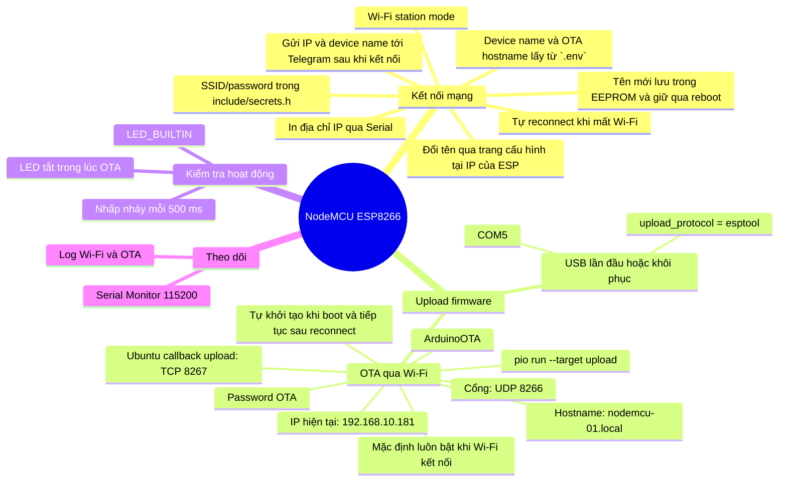

# Bản đồ tính năng ESP8266

Firmware hiện tại chỉ tập trung vào hai chức năng: **OTA qua Wi-Fi** và
**nhấp nháy LED để kiểm tra thiết bị đang chạy**. Thiết bị là NodeMCU ESP8266
(`nodemcuv2`), không phải ESP32.

## Mind map



## Trạng thái tính năng

| Tính năng | Trạng thái | Ghi chú |
|---|---|---|
| Kết nối Wi-Fi | Đã có | Tự kết nối và reconnect |
| Thông báo trạng thái Telegram | Đã có | Gửi `ESP Agent 01` và IP qua Telegram sau boot/reconnect |
| Đổi tên qua trình duyệt | Đang phát triển | Mở `http://<IP-ESP>/`, lưu tên mới trong LAN; cập nhật tên Telegram và hostname OTA |
| Upload firmware qua USB | Đã có | Dùng `COM5` khi cần khôi phục |
| Upload firmware qua Wi-Fi | Đã có, mặc định luôn bật | Tự khởi động ArduinoOTA sau khi Wi-Fi kết nối; OTA tới `192.168.10.181` |
| Upload từ máy tính khác trong LAN | Đã có | Máy tính và ESP phải cùng mạng |
| Upload qua Internet | Chưa có trực tiếp | Nên dùng VPN hoặc cơ chế HTTPS pull update |
| Nhấp nháy LED kiểm tra | Đã có | LED tích hợp, chu kỳ 500 ms |
| Gửi HTTP POST | Đã bỏ | Không còn trong firmware hiện tại |
| Offline queue/LittleFS | Đã bỏ | Không còn trong firmware hiện tại |
| Đồng bộ NTP | Đã bỏ | Không còn trong firmware hiện tại |
| Health check server | Đã bỏ | Không còn trong firmware hiện tại |
| Cảm biến | Chưa có | Chưa có trong firmware hiện tại |

## Thông tin cấu hình hiện tại

### Upload OTA

Trong [platformio.ini](./platformio.ini):

```ini
upload_protocol = espota
upload_port = 192.168.10.181
```

OTA là tính năng mặc định của firmware và không có cờ tắt theo build. Sau mỗi
lần khởi động, firmware sẽ tự khởi tạo ArduinoOTA ngay khi Wi-Fi kết nối;
nếu Wi-Fi bị mất, firmware tự reconnect và tiếp tục duy trì OTA khi kết nối
trở lại. Khi upload từ Ubuntu, PlatformIO dùng `192.168.10.135:8267` làm
callback TCP cố định; firewall Ubuntu phải cho phép cổng này từ mạng LAN.

`OTA_PASSWORD` và cờ `--auth` được lấy tự động từ `.env` khi chạy
PlatformIO; không ghi password vào `platformio.ini`.

Upload firmware mới:

```powershell
pio run --target upload
```

Điều kiện:

- ESP vẫn được cấp nguồn.
- ESP và máy tính cùng mạng LAN/Wi-Fi.
- IP `192.168.10.181` chưa bị router cấp cho thiết bị khác.
- OTA password trong `platformio.ini` phải trùng với firmware đang chạy.
- Firmware đã kết nối Wi-Fi và in log `[OTA] ready at nodemcu-01.local`.

Nếu IP thay đổi, xem log bằng USB:

```powershell
pio device monitor --port COM5 --baud 115200
```

Tìm dòng:

```text
[WiFi] connected, ip=192.168.10.xxx
[OTA] ready at nodemcu-01.local
```

Sau đó cập nhật `upload_port`.

### Cấu hình Wi-Fi và OTA

Thông tin cục bộ nằm trong `.env` (tạo từ `.env.example`). Script
`scripts/load_env.py` nạp các giá trị này vào lúc PlatformIO build và upload:

```cpp
WIFI_SSID=...
WIFI_PASSWORD=...
OTA_PASSWORD=...
DEVICE_NAME=ESP Agent 01
OTA_HOSTNAME=nodemcu-01
```

Thông báo Telegram dùng các biến cấu hình cục bộ sau:

```text
TELEGRAM_GATEWAY_URL=http://192.168.10.135:3000
TELEGRAM_CHAT_ID=-5350283159
INTERNAL_API_TOKEN=...
```

Mỗi ESP cần một `DEVICE_NAME` và `OTA_HOSTNAME` duy nhất; khi thêm thiết bị,
chỉ cần tạo `.env` riêng cho thiết bị đó và build cùng firmware mặc định.
Không ghi chat ID hoặc token thật vào source code; các giá trị được nạp từ
`.env` khi build. Sau mỗi lần ESP kết nối Wi-Fi, firmware gửi một thông báo
plain-text qua `POST /internal/messages/v1` với device name cấu hình được và
địa chỉ IP.
Sau khi mở `http://<IP-ESP>/` trong cùng mạng LAN, có thể nhập tên mới và
nhấn **Save**. Tên hiển thị Telegram và hostname OTA `.local` được cập nhật
ngay, đồng thời lưu trong EEPROM để giữ lại sau reboot. Hostname OTA được
chuẩn hóa từ tên hiển thị (chữ thường, dấu cách thành dấu gạch ngang).
Nếu gateway tạm thời chưa sẵn sàng, firmware retry mỗi 10 giây cho đến khi
request được gateway chấp nhận. Idempotency key chứa chip ID và boot counter
lưu trong EEPROM, nên reboot luôn tạo delivery mới thay vì bị gateway nhận
diện là request trùng lặp.

`include/secrets.h` chỉ ánh xạ các macro do script cung cấp, không chứa secret
thật. Không đưa `.env` hoặc password thật lên Git hay chia sẻ công khai.

## Quy trình vận hành nhanh

### Upload code mới khi ESP ở xa trong nhà

```text
1. ESP được cấp nguồn
2. ESP kết nối Wi-Fi
3. Máy tính cùng mạng Wi-Fi
4. Kiểm tra IP trong platformio.ini
5. Chạy: pio run --target upload
6. Chờ Result: OK
```

### Khôi phục khi OTA không hoạt động

```ini
upload_protocol = esptool
upload_port = COM5
```

Sau đó nạp qua USB:

```powershell
pio run --target upload
```

Đây chỉ là quy trình khôi phục tạm thời. Khi khôi phục xong, đổi lại
`upload_protocol = espota` và IP OTA để giữ OTA mặc định luôn bật.

## Sơ đồ hoạt động

```text
NodeMCU ESP8266
   │
   ├── Wi-Fi ──> OTA server tích hợp (UDP 8266)
   │                └── PlatformIO upload firmware
   │
   └── Telegram Gateway ──> Telegram
          └── Device name và IP sau boot/reconnect
   │
   └── HTTP :80 (LAN) ──> Trang đổi tên
          └── EEPROM + Telegram + OTA hostname
   │
   └── LED_BUILTIN
          └── Nhấp nháy mỗi 500 ms
```

## Quy trình cập nhật trong quá trình develop

Mỗi khi thêm, sửa hoặc xóa một tính năng, cập nhật file này trong cùng thay đổi
với code. Không đợi đến cuối dự án mới cập nhật bản đồ.

### Checklist cho mỗi tính năng mới

1. Thêm hoặc sửa nhánh tương ứng trong **Mind map**.
2. Thêm một dòng trong **Trạng thái tính năng**.
3. Cập nhật phần **Thông tin cấu hình** nếu có URL, port, password, lệnh hoặc
   điều kiện vận hành mới.
4. Cập nhật **Sơ đồ dữ liệu** nếu tính năng tạo thêm kết nối hoặc luồng dữ liệu.
5. Ghi rõ cách kiểm tra tính năng ở phần **Quy trình vận hành nhanh**.
6. Build và kiểm tra firmware trước khi đánh dấu `Đã có`.

### Quy ước trạng thái

| Trạng thái | Ý nghĩa |
|---|---|
| `Đã có` | Đã code và đã kiểm tra thực tế |
| `Đang phát triển` | Đã bắt đầu nhưng chưa hoàn thiện hoặc chưa kiểm tra đủ |
| `Đã lên kế hoạch` | Có yêu cầu nhưng chưa code |
| `Chưa có` | Chưa hỗ trợ |
| `Tạm tắt` | Có code nhưng đang bị vô hiệu hóa có chủ đích |

### Mẫu cập nhật nhanh

Khi thêm một tính năng, dùng mẫu sau để tránh bỏ sót:

```text
Tên tính năng:
Trạng thái:
File/symbol liên quan:
Cấu hình mới:
Cách sử dụng:
Cách kiểm tra:
Ảnh hưởng đến sơ đồ dữ liệu:
```

### Cách duy trì tự động hơn

- Đặt file này ở thư mục gốc project và luôn review cùng với code.
- Khi tạo Pull Request hoặc commit tính năng, kiểm tra xem bảng trạng thái và
  mind map đã được cập nhật chưa.
- Có thể thêm mục `Documentation update` vào template Pull Request.
- Có thể dùng CI để kiểm tra file tồn tại và kiểm tra build, nhưng CI không thể
  tự hiểu chính xác ý nghĩa của tính năng; phần mô tả vẫn cần cập nhật có chủ ý.
- Không ghi password, token hoặc thông tin nhạy cảm thật vào bản đồ.

### Nguyên tắc source of truth

- Code là nguồn sự thật về hành vi thực tế.
- `ESP_FEATURE_MAP.md` là nguồn tra cứu về tính năng và cách vận hành.
- `platformio.ini` là nguồn sự thật về cấu hình build/upload.
- `.env` là cấu hình cục bộ và không được đưa password thật vào Git
  tài liệu hoặc repository công khai.

Nếu bản đồ và code không khớp, ưu tiên sửa bản đồ ngay trong cùng commit với
thay đổi code; không để trạng thái `Đã có` nếu chưa có kiểm tra tương ứng.
